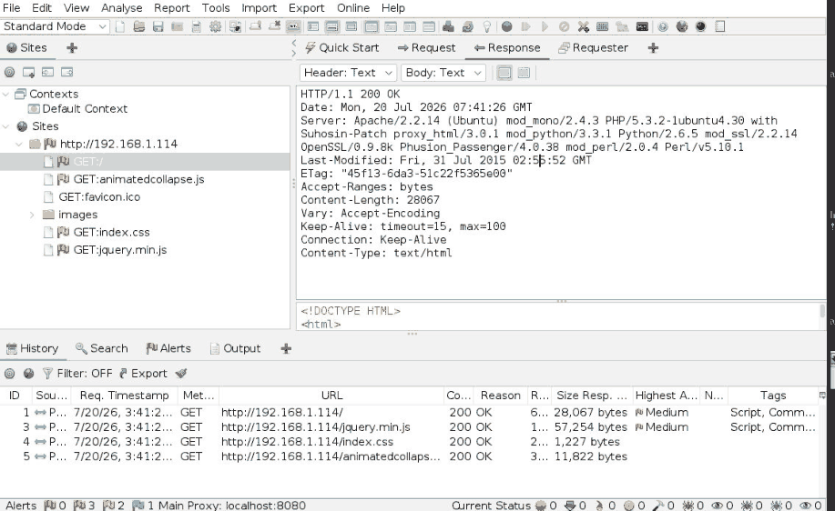
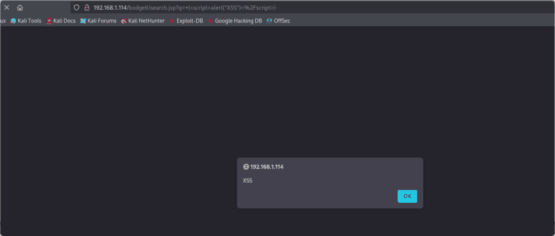
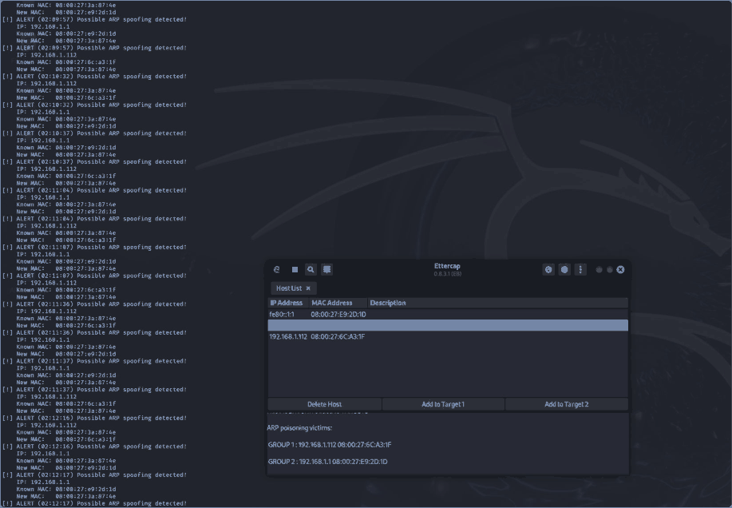
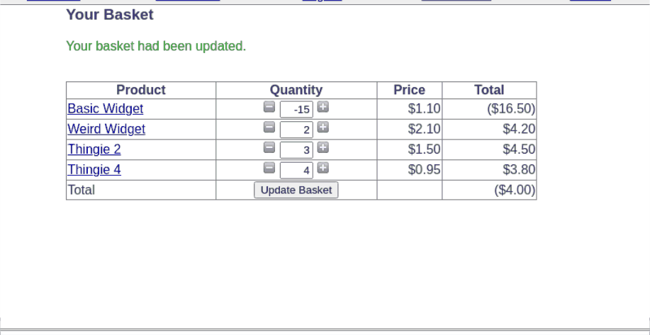

# Ethical Hacking Portfolio - SIT379

A task-by-task account of my university ethical hacking work: building an isolated lab, investigating vulnerable services, analysing network traffic, testing web applications and reviewing mobile/IoT security.

The emphasis is on explaining what I tested, what the evidence supports and what I would improve. All practical activity described here was conducted as coursework in a controlled lab. This is documentation of historical exercises, not a collection of deployable offensive payloads.

## Start here

- [Lab environment and boundaries](docs/lab-environment.md)
- [Evidence standards and technical corrections](docs/evidence-and-limitations.md)
- [Learning reflection](docs/reflection.md)
- [Source coverage](docs/source-map.md)

## Task documentation

| Task | Investigation | Source status |
| --- | --- | --- |
| 1.1P | [Ethics and engagement scope](tasks/1.1p-ethics-and-engagement-scope.md) | Complete |
| 1.2P | [Virtual lab setup and network isolation](tasks/1.2p-virtual-lab-setup-and-network-isolation.md) | Complete |
| 2.1P | [Reconnaissance and network scanning](tasks/2.1p-reconnaissance-and-network-scanning.md) | Complete |
| 2.2C | [Offline website mirroring](tasks/2.2c-offline-website-mirroring.md) | Complete |
| 2.3D | [Firewall rule inference](tasks/2.3d-firewall-rule-inference.md) | Complete |
| 3.1P | [Service enumeration and vulnerability analysis](tasks/3.1p-service-enumeration-and-vulnerability-analysis.md) | Complete |
| 3.2C | [FTP exposure with Metasploit scanners](tasks/3.2c-ftp-exposure-with-metasploit-scanners.md) | Complete |
| 4.1P | [SLMail buffer overflow investigation](tasks/4.1p-slmail-buffer-overflow-investigation.md) | Complete |
| 4.2D | [Payload handling and Windows privilege context](tasks/4.2d-payload-handling-and-windows-privilege-context.md) | Complete |
| 5.1P | [ARP poisoning and DNS response analysis](tasks/5.1p-arp-poisoning-and-dns-response-analysis.md) | Complete |
| 5.2C | [ARP change detection and network identity tests](tasks/5.2c-arp-change-detection-and-network-identity-tests.md) | Complete |
| 5.3D | [Telnet injection and HTTP interception](tasks/5.3d-telnet-injection-and-http-interception.md) | Complete |
| 6.1P | [Phishing simulation and availability testing](tasks/6.1p-phishing-simulation-and-availability-testing.md) | Complete |
| 6.2C | [HTTP request pressure and mitigation evaluation](tasks/6.2c-http-request-pressure-and-mitigation-evaluation.md) | Complete |
| 7.1P | [Pivoting across segmented networks](tasks/7.1p-pivoting-across-segmented-networks.md) | Complete |
| 7.2D | [SSH authentication and web configuration review](tasks/7.2d-ssh-authentication-and-web-configuration-review.md) | Complete |
| 8.1P | [Web application vulnerability investigations](tasks/8.1p-web-application-vulnerability-investigations.md) | Complete |
| 8.2C | [Request tampering and upload validation](tasks/8.2c-request-tampering-and-upload-validation.md) | Complete |
| 9.1P | [Android session and APK analysis](tasks/9.1p-android-session-and-apk-analysis.md) | Complete |
| 9.2C | [Android debugging exposure and platform comparison](tasks/9.2c-android-debugging-exposure-and-platform-comparison.md) | Complete |
| 10.1P | [MQTT traffic and cloud footprint analysis](tasks/10.1p-mqtt-traffic-and-cloud-footprint-analysis.md) | Complete |

## What this portfolio demonstrates

- Virtual networking, segmentation and connectivity troubleshooting.
- Reconnaissance, service enumeration and cautious interpretation of scanner findings.
- Debugger-led investigation of a legacy memory-corruption exercise.
- Network packet analysis, address-resolution anomalies and basic detection logic.
- Web input handling, authentication, upload and business-logic weaknesses.
- Android permission/component review and controlled debugging exposure.
- MQTT authentication/traffic analysis and passive cloud metadata review.

## Evidence and provenance

This repository is adapted from the supplied SIT379 portfolio, whose printed body spans 206 pages; the PDF has 211 physical pages including the opening reflection. Task titles here are descriptive editorial titles, while task identifiers retain the original mapping. The status column reproduces the source snapshot; it does not claim a final grade. Three HD project milestones appear only as Not Started in the source and have no submitted work to document.

The full assessment PDF, task sheets, tutor conversations, student number, credential values and device data are excluded. Source page references allow the owner to compare these write-ups against the original without publishing the entire assessment. Selected screenshot excerpts accompany all 20 practical tasks, with captions explaining what the evidence supports. The ethics acknowledgement has no practical screenshot. There are no packet captures, executables or offensive scripts in this repository.

The documentation was reorganised and edited with AI assistance. The original portfolio also acknowledges AI assistance for some writing, scripting and lab planning. No tests were rerun during this conversion. Remediation sections are recommendations, not claims of fixes implemented and retested.

## Use and attribution

This is a personal learning portfolio. Tools, application names and referenced materials belong to their respective owners. No open-source licence is asserted for university material or third-party code. Use these notes to understand the investigations, and obtain permission and scope before performing any security testing.

## Visual evidence

Open each practical task to see its screenshot and evidence caption. Screenshots are historical excerpts from the original lab portfolio; they do not represent new tests.

| Network and service analysis | Web application testing |
| --- | --- |
|  |  |
|  |  |

[Full screenshot source map](docs/source-map.md#screenshot-source-pages)
