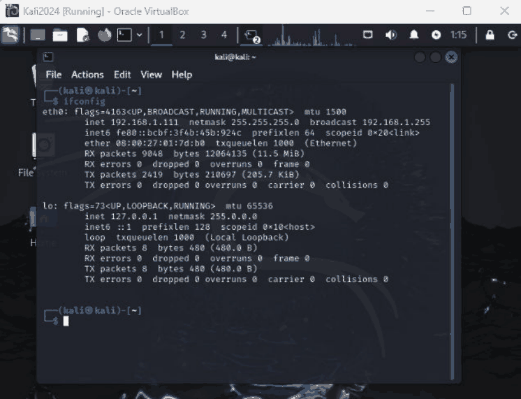

# Task 1.2P: Virtual lab setup and network isolation

[Back to portfolio](../README.md)

**Tools and concepts:** VirtualBox, pfSense, Windows 10, internal networks, connectivity testing

**Source:** supplied SIT379 portfolio, physical PDF pages 14-18 (counting the first reflection page as page 1).

**Assessment snapshot:** Complete. This describes the uploaded portfolio, not a later or final grade.

## Objective
Build a segmented virtual environment for controlled security exercises.

## Method
1. Configured virtual machines and pfSense interfaces using NAT and named internal networks.
2. Tested connectivity to a known public IP and then to a domain name.
3. Used the internal segments `intnet` and `intnet2` to separate the lab targets.
4. Corrected the second-segment configuration after the initial setup did not show the expected address range.

## Findings
Successful IP connectivity supported that routing and outbound translation worked. A successful hostname test additionally supported working name resolution. These are useful separate checks because a DNS failure can occur while IP connectivity still works.

VirtualBox internal networks with different names are separate segments unless a host routes or bridges between them. The dual-homed Windows host later provided a controlled pivot point.

## Limits and defensive application
A successful internet ping does not prove lab isolation. Validate interface attachments and routes as well as reachability. Internet access used for setup should not create an unintended path from vulnerable targets to the home network. Recheck segment membership before each exercise.

## Reflection
Building and troubleshooting the topology made segmentation concrete: security depends on which hosts can communicate and through which controlled paths.

## Screenshot evidence

*Kali network interface output records the lab address and interface state; connectivity and isolation require the additional checks discussed above. Source: physical PDF page 17. Screenshot excerpt; cropped where needed to omit unrelated or identifying information.*
