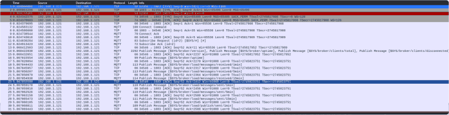

# Task 10.1P: MQTT traffic and cloud footprint analysis

[Back to portfolio](../README.md)

**Tools and concepts:** Mosquitto, MQTT, Wireshark, Nmap, AWS published ranges, jq, WHOIS

**Source:** supplied SIT379 portfolio, physical PDF pages 201-211 (counting the first reflection page as page 1).

**Assessment snapshot:** Complete. This describes the uploaded portfolio, not a later or final grade.

## Objective
Inspect an intentionally permissive MQTT broker and use published cloud metadata for passive infrastructure analysis.

## Task B1: MQTT capture
Identified a PUBLISH message on the `Test` topic and discussed fixed-header flags such as duplicate delivery, quality of service and retention. Plain MQTT on port 1883 exposed readable topic/message information in the lab.

## Task B2: broker enumeration
Used the Nmap MQTT subscription script against the lab broker. The submission reports port 1883 open and a Mosquitto version banner. The capture distinguished a half-open SYN probe from a later full TCP session used by the script. It then records MQTT CONNECT/CONNACK, subscription to `$SYS/#`, acceptance and published statistics.

Accepted connection/subscription without supplied credentials is stronger evidence of anonymous access than a high packet count. A SYN/SYN-ACK/RST sequence is consistent with discovery; it is not alone proof of hostile intent. The version is a source-reported observation, not independently verified software metadata.

## Task B3: passive cloud analysis
Downloaded AWS's published IP-range JSON, checked its metadata, counted entries, filtered EC2/Sydney ranges and used registry lookups. The source records 10,528 IPv4 entries for its September 2026 snapshot; this is historical and is not a current count.

An AWS allocation supports provider/region analysis but does not identify a particular customer, establish trust or authorise scanning. The original 'whoami' wording is corrected to WHOIS in this documentation.

## Defensive recommendations and reflection
Require broker authentication and topic-level authorisation, restrict network access and enable TLS with certificate validation. Cloud customers must secure identities, configuration and workloads within their responsibility. Published provider ranges are useful scoping context, not proof of asset ownership.

## Screenshot evidence

*The packet list records TCP discovery followed by MQTT connection, subscription and published broker information. These are separate protocol phases. Source: physical PDF page 206. Screenshot excerpt; cropped where needed to omit unrelated or identifying information.*
