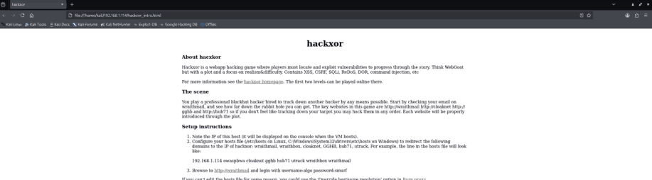

# Task 2.2C: Offline website mirroring

[Back to portfolio](../README.md)

**Tools and concepts:** HTTrack, Linux command line, Windows GUI, local browsing

**Source:** supplied SIT379 portfolio, physical PDF pages 33-42 (counting the first reflection page as page 1).

**Assessment snapshot:** Complete. This describes the uploaded portfolio, not a later or final grade.

## Objective
Create a local website mirror and inspect the material without repeatedly visiting the target.

## Method
1. Used HTTrack in the lab to collect accessible website content.
2. Inspected the generated directory structure and HTML files.
3. Repeated mirroring through the Windows interface.
4. Opened the local copy in a browser; the portfolio records subsequent confirmation of Windows viewing.

## Findings
A local mirror made page source, linked resources and application paths available for offline review. The initial crawl still generated traffic to the target. Subsequent browsing can avoid that traffic only when the required content is local and the browser does not fetch external dependencies.

## Technical clarification
A mirror normally retrieves content served to the client. It does not automatically recover private server-side PHP source, database contents or the original backend application. The original statement about copying backend files should be read as copied web resources, unless a server separately exposed source code.

`Ctrl+Z` suspends a foreground process; it does not by itself continue the crawl in the background. Do not infer that a mirror finished merely because files were created.

## Defensive application and reflection
Review public content for accidental source disclosure and remove sensitive files from the web root. Mirroring showed how ordinary published resources can reveal useful structure before exploitation begins.

## Screenshot evidence

*A browser view of content collected during the website-mirroring exercise. A local mirror contains served resources rather than private backend source. Source: physical PDF page 36. Screenshot excerpt; cropped where needed to omit unrelated or identifying information.*
