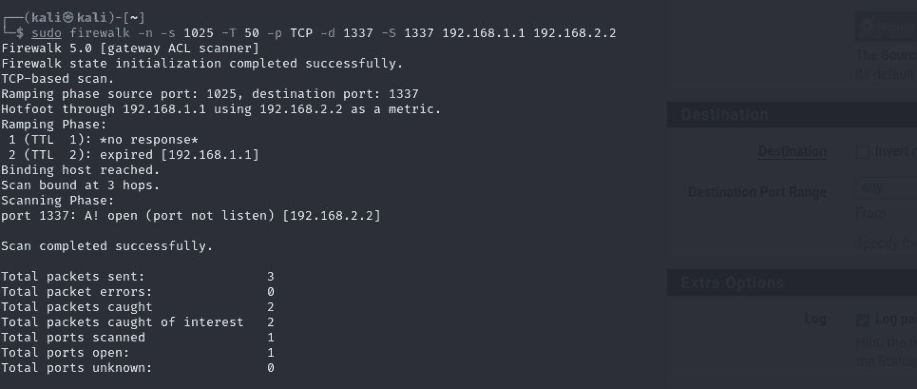

# Task 2.3D: Firewall rule inference

[Back to portfolio](../README.md)

**Tools and concepts:** pfSense, traceroute, Firewalk, TTL, filtering

**Source:** supplied SIT379 portfolio, physical PDF pages 43-47 (counting the first reflection page as page 1).

**Assessment snapshot:** Complete. This describes the uploaded portfolio, not a later or final grade.

## Objective
Compare observed packet behaviour with the firewall rules separating two lab segments.

## Method
- Allowed the designated lab port, 1337, across the firewall.
- Compared traceroute behaviour on the permitted port and another port.
- Used Firewalk to infer whether probes passed the filtering boundary.
- Changed the firewall to block traffic and repeated the comparison.

## Findings
The submission reports `A! open (port not listen)` for the allowed path. This supports a distinction between a firewall allowing traffic and a destination application actually listening. After blocking the path, the tool received no useful response.

## Interpretation and correction
Reject and drop behaviour can produce different responses. A reset must be interpreted with its source and the configured rule; it does not automatically prove the destination service answered. The original discussion of hop numbering is ambiguous and should not be used as a precise topology measurement.

The portfolio feedback corrects the explanation of `-T`: increasing the timeout gives the tool longer to wait for slow responses. It is not evidence that packets arrived too quickly for the tool. No exact timeout unit is asserted here because the installed version's help was not captured in readable text.

## Defensive application
Validate firewall rules using both permitted and denied traffic, firewall logs and packet captures on relevant interfaces. Silence can result from filtering, loss or missing responses; triangulate rather than equating silence with a confirmed rule.

## Screenshot evidence

*Firewalk reports a probe passing the rule while the destination port is not listening. Firewall permission and an active service are distinct observations. Source: physical PDF page 46. Screenshot excerpt; cropped where needed to omit unrelated or identifying information.*
