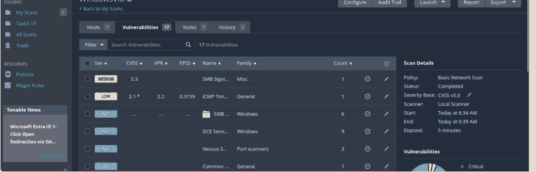

# Task 3.1P: Service enumeration and vulnerability analysis

[Back to portfolio](../README.md)

**Tools and concepts:** Nmap, SMTP, FTP, SMB, vulnerability scanning

**Source:** supplied SIT379 portfolio, physical PDF pages 48-54 (counting the first reflection page as page 1).

**Assessment snapshot:** Complete. This describes the uploaded portfolio, not a later or final grade.

## Objective
Move from identifying open ports to explaining what services expose and why it matters.

## Work documented
- **B1:** queried supported SMTP commands on port 25.
- **B2:** tested SMTP VRFY manually. A generic `252` response did not reliably distinguish valid accounts.
- **B3:** examined anonymous FTP and discussed the legacy vsftpd backdoor associated with the intentionally vulnerable target.
- **B4-B5:** interpreted scanner findings for SMB signing not required and ICMP timestamp disclosure, and considered the scanner's remediation guidance.
- **B6:** prioritised signing enforcement, restricted SMB reachability, unique local credentials and reduced information disclosure.

## Findings
The source records a medium-rated SMB signing finding (5.3) and a low-rated ICMP timestamp finding (2.1). These are the scanner values in this lab, not universal risk ratings. SMB exposure and optional signing can contribute to relay or tampering paths when other conditions are present.

## Evidence boundaries
An open port is an attack surface, not inherently a vulnerability. A version banner alone does not prove a particular compromised vsftpd build is present. SMTP command support is not proof of reliable username enumeration. This task documents enumeration and analysis, not successful exploitation of every finding.

## Defensive recommendations
Require SMB signing where compatible, restrict file-sharing access, reduce anonymous enumeration and disable unnecessary services. Verify fixes through configuration checks and a repeat scan.

## Reflection
Severity needs context. A moderate configuration finding can become more significant when combined with weak credentials or broad network access.

## Screenshot evidence

*The scanner lists the SMB signing and ICMP timestamp findings discussed in this task. Ratings are the recorded lab results. Source: physical PDF page 52. Screenshot excerpt; cropped where needed to omit unrelated or identifying information.*
