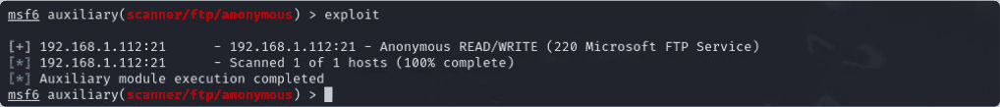

# Task 3.2C: FTP exposure with Metasploit scanners

[Back to portfolio](../README.md)

**Tools and concepts:** Metasploit auxiliary modules, TCP scanning, anonymous FTP

**Source:** supplied SIT379 portfolio, physical PDF pages 55-58 (counting the first reflection page as page 1).

**Assessment snapshot:** Complete. This describes the uploaded portfolio, not a later or final grade.

## Objective
Use auxiliary scanners to identify an exposed FTP service and assess its access policy.

## Method
1. Opened Metasploit and selected its TCP port-scanning auxiliary module.
2. Restricted the scan to ports 1-100 on the Windows lab host.
3. Observed ports 21 and 79 in the reported results.
4. Used an FTP scanner to assess anonymous access.

## Findings
The submission reports anonymous access to Microsoft FTP Service and describes read/write permissions configured for the exercise. Such permissions can expose files and permit untrusted uploads.

## Evidence limits
The configured 1-100 range included port 21; it was not a scan of port 21 alone. An anonymous-login result proves authentication behaviour, but separate successful upload/download operations are needed to establish the exact permissions. The auxiliary scanner did not itself provide a Windows shell or prove execution of uploaded content.

## Defensive recommendations
Disable anonymous FTP unless it is a specific requirement. If anonymous distribution is needed, separate it from sensitive data and remove write access. Use authenticated, encrypted transfer where appropriate and monitor uploads.

## Reflection
An auxiliary module can establish a useful finding without exploitation. The important reporting distinction is between service discovery, authentication success, file permissions and host compromise.

## Screenshot evidence

*The FTP scanner reports anonymous READ/WRITE on the Windows lab service. This is scanner evidence; separate file operations would strengthen permission validation. Source: physical PDF page 58. Screenshot excerpt; cropped where needed to omit unrelated or identifying information.*
