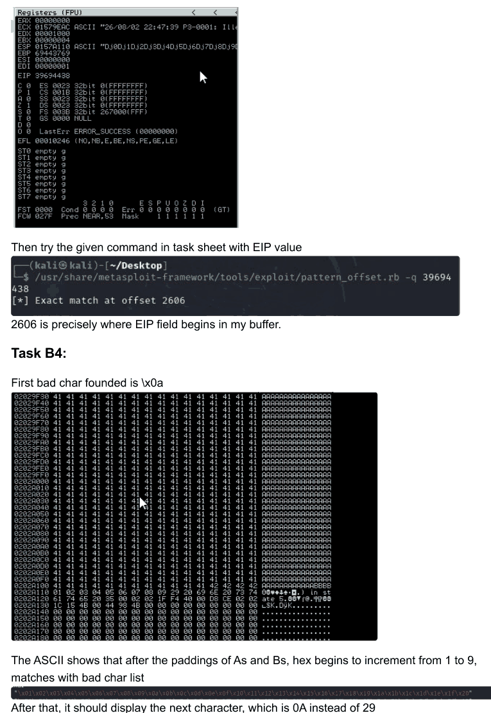

# Task 4.1P: SLMail buffer overflow investigation

[Back to portfolio](../README.md)

**Tools and concepts:** SLMail, Immunity Debugger, EIP, ESP, pattern offsets, reverse shell

**Source:** supplied SIT379 portfolio, physical PDF pages 59-68 (counting the first reflection page as page 1).

**Assessment snapshot:** Complete. This describes the uploaded portfolio, not a later or final grade.

## Objective
Understand how a memory-corruption fault can affect program control flow in a deliberately vulnerable service.

## Investigation
- **B1:** explained the roles of the stack pointer (ESP) and instruction pointer (EIP).
- **B2:** observed a service crash after approximately 3,900 bytes of input.
- **B3:** used a cyclic pattern and the overwritten EIP value to calculate an offset of 2,606 bytes.
- **B4:** investigated byte handling and identified `0x0a` and `0x0d` as problematic in the documented tests.
- **B5-B6:** completed the guided exploitation exercise and checked the resulting host and account identity.

## Results
The submission records a shell on the Windows SLMail host as `NT AUTHORITY\SYSTEM`. This was not a separate escalation from an ordinary account: the vulnerable service already ran with SYSTEM privileges, so code execution inherited that context.

*Excerpt from physical PDF page 66. The image documents debugger observations, not a standalone exploit.*

## Interpretation
A crash alone does not prove code execution. Controlled overwrite, reliable redirection and a resulting session are separate observations. Bad characters can terminate or transform input before it reaches the intended memory location; they are specific to the input path and encoding. The two documented bytes should not be treated as an exhaustive portable list.

## Defensive recommendations
Replace obsolete software, use supported memory protections, constrain service privileges and restrict access to administrative services.

## Reflection
The offset and byte tests required careful evidence reading. Encoding mistakes or a single incorrect assumption can invalidate later steps even when a service crashes.
