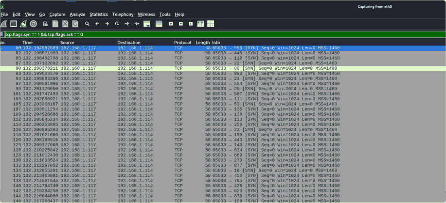

# Task 6.1P: Phishing simulation and availability testing

[Back to portfolio](../README.md)

**Tools and concepts:** Controlled phishing exercise, Wireshark, SYN traffic, slowhttptest

**Source:** supplied SIT379 portfolio, physical PDF pages 119-128 (counting the first reflection page as page 1).

**Assessment snapshot:** Complete. This describes the uploaded portfolio, not a later or final grade.

## Objective
Study the different evidence produced by human-focused deception and resource-exhaustion tests in the isolated lab.

## Task B1: phishing simulation
The Windows test machine received an impersonation email linking to a local lab page. The submission reports that form POST data appeared in the Kali terminal. This demonstrates collection in the exercise, not compromise of a real GitHub account. Email addresses, submitted values and the phishing page are not republished.

## Task B2: SYN traffic
Used the Wireshark filter `tcp.flags.syn == 1 && tcp.flags.ack == 0` to isolate initial connection requests. The report describes repeated SYN/SYN-ACK exchanges without a completed handshake and increased target resource usage.

These observations are consistent with connection pressure, but the portfolio does not provide a controlled numerical before/during/after dataset or a measured outage duration. A high packet count alone is insufficient to prove denial of service.

## Task B3: slow HTTP attempt
Attempted a Slowloris-style test against the vulnerable web VM. The recorded result indicated that a target connection could not be established. It is an unsuccessful or inconclusive execution, even though later browser behaviour was also checked.

## Defensive recommendations
Verify unexpected account-security requests through a trusted channel, use phishing-resistant authentication where available, and report suspicious messages. For availability, combine connection/time limits, suitable network protections, monitoring and a recovery plan.

## Reflection
A tool launching and an attack succeeding are different milestones. Include legitimate-client response measurements and recovery evidence in future availability tests.

## Screenshot evidence

*The capture shows repeated connection-initiation traffic using the documented SYN filter. Traffic volume alone does not establish service unavailability. Source: physical PDF page 124. Screenshot excerpt; cropped where needed to omit unrelated or identifying information.*
