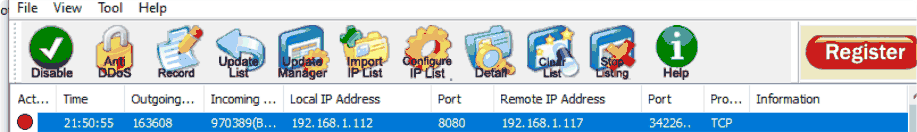

# Task 6.2C: HTTP request pressure and mitigation evaluation

[Back to portfolio](../README.md)

**Tools and concepts:** LOIC HTTP mode, Python web server, curl, Anti-DDoS Guardian, Task Manager

**Source:** supplied SIT379 portfolio, physical PDF pages 129-149 (counting the first reflection page as page 1).

**Assessment snapshot:** Time Exceeded; final assessment not shown. This describes the uploaded portfolio, not a later or final grade.

## Objective
Assess availability of a small Windows-hosted test page and observe a host-based protection tool.

## Work documented
- **1.1-1.2:** selected an HTTP request-volume test and explained how it differs from holding slow connections open.
- **1.3:** adapted the setup for the 32-bit Windows VM and used a Python test server.
- **1.4:** checked the page and exposed port before the controlled request-pressure test. The submission reports more than 2,400 requests, a curl status of `000` and an unresponsive VM.
- **1.5:** configured connection/data thresholds in Anti-DDoS Guardian and recorded a detection/block entry associated with the Kali lab host, alongside resource observations.
- **1.6:** reflected on AI assistance in planning and compatibility troubleshooting, and the need to verify suggestions experimentally.

## Interpretation and limits
Curl `000` is not an HTTP response code and does not alone prove the server was down. It indicates no usable HTTP status was obtained; the exit code and error text are needed to distinguish timeout, connection failure or another cause.

The source alternates between ports 8000 and 8080. This remains unresolved. Its threshold descriptions are also not precise enough to recreate a validated protection policy. A block event is evidence of detection/action, but not proof that legitimate service availability was restored.

## Defensive follow-up
Record the actual listener and test URL, collect time-stamped latency/error rates and resources, and repeat legitimate-client checks before, during and after mitigation. Distinguish application bottlenecks from VM host contention. Use a supported production web server rather than interpreting a development server as a representative production target.

## Screenshot evidence

*The protection tool records the Kali lab source communicating with the Windows test service. This excerpt is part of the mitigation evidence and does not by itself establish restored availability. Source: physical PDF page 146. Screenshot excerpt; cropped where needed to omit unrelated or identifying information.*
