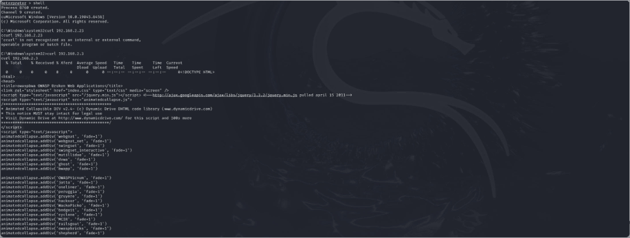

# Task 7.1P: Pivoting across segmented networks

[Back to portfolio](../README.md)

**Tools and concepts:** Metasploit, dual-homed Windows host, routing, curl, service discovery

**Source:** supplied SIT379 portfolio, physical PDF pages 150-154 (counting the first reflection page as page 1).

**Assessment snapshot:** Complete. This describes the uploaded portfolio, not a later or final grade.

## Objective
Reach an otherwise isolated lab segment through a host with interfaces on both networks.

## Work documented
The submission describes using an existing controlled session on the dual-homed Windows host as the intermediate point. It records service identification on the second-segment target and a web request issued from Windows using curl.

Reported services include SSH (22), HTTP (80), NetBIOS session service (139), IMAP (143), HTTPS (443) and SMB (445). These are observations for the lab host, not an inventory of a production network.

## Interpretation
There are two distinct approaches: running a command on the intermediate host, or routing supported tools through a session. A Metasploit route is generally framework-specific; it does not automatically route every operating-system application without additional forwarding/proxy configuration.

A successful request from the Windows shell supports reachability from Windows. It should not be over-described as proof that every Kali tool had direct access to the second network.

## Defensive recommendations
Constrain inter-segment traffic to necessary services, review dual-homed systems, apply host firewalls and monitor unexpected flows crossing trust boundaries. Segmentation is weakened when an intermediate endpoint can freely access both sides.

## Reflection
Routing and subnetting knowledge explained the mechanism. A diagram alone would not establish isolation; the important evidence is the difference between direct reachability and reachability through the permitted intermediate host.

## Screenshot evidence

*A Windows shell on the intermediate host retrieves the second-segment web page. This establishes reachability from that host, not automatic routing for every Kali application. Source: physical PDF page 153. Screenshot excerpt; cropped where needed to omit unrelated or identifying information.*
